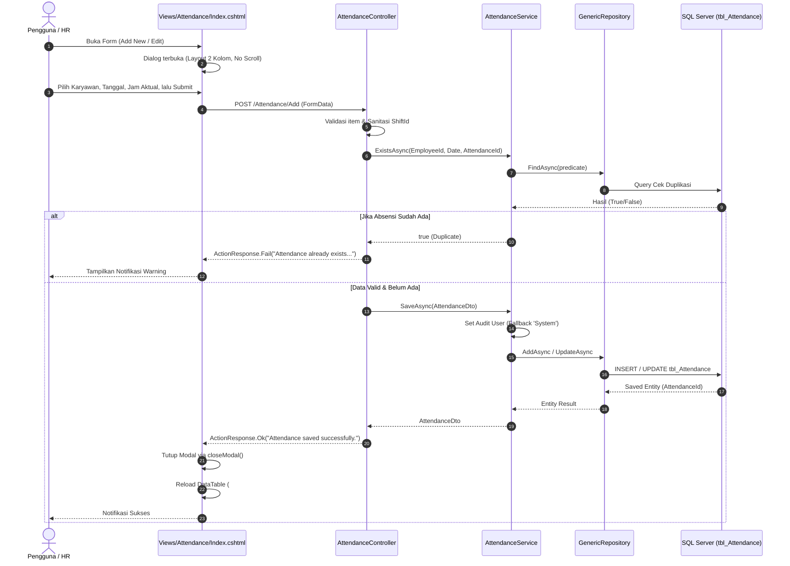

# 📊 Analisa Modul Absensi (Attendance) — MiniPayroll

> **Tanggal Analisa:** 22 November 2026  
> **Project:** MiniPayroll — ASP.NET Core MVC (.NET 10)  
> **Arsitektur:** Clean Architecture (`App.Domain` → `App.Application` → `App.Infrastructure` → `App.UI.Web`)  
> **Lokasi File Dokumentasi:** `C:\Local\Backup\New folder\MiniPayroll\App.Docs\attendance-module.md`

---

## 1. 🏗️ Ringkasan & Arsitektur Modul Attendance

Modul Attendance bertugas mencatat dan mengelola kehadiran harian karyawan, membandingkan jadwal shift (*scheduled time*) dengan kehadiran aktual (*actual time*), serta menghitung metrik kedisiplinan dan kompensasi (menit keterlambatan, pulang awal, total jam kerja, dan jam lembur).

### Struktur Komponen Modul:
```
MiniPayroll/App/
├── App.Domain/
│   ├── Entities/
│   │   ├── TblAttendance.cs            → Entitas tabel utama dbo.tbl_Attendance
│   │   ├── VwAttendance.cs             → Entitas view dbo.vw_Attendance
│   │   └── TblAttendanceStatus.cs      → Master status kehadiran
│   ├── Enums/
│   │   └── AttendanceStatus.cs         → Enum: Present, Late, Absent, Leave, Holiday, RestDay, dll.
│   └── Models/Dto/Attendance/
│       └── AttendanceDto.cs            → AttendanceDto & VwAttendanceDto
│
├── App.Application/
│   └── Interfaces/Services/Attendance/
│       └── IAttendanceService.cs       → Kontrak layanan absensi (CRUD & Paged Query)
│
├── App.Infrastructure/
│   ├── Services/Attendance/
│   │   └── AttendaceService.cs         → Implementasi logika bisnis absensi & mapping
│   ├── Data/
│   │   └── AppDBContext.cs             → Konfigurasi EF Core DbSet & model mapping
│   └── Repositories/
│       └── GenericRepository.cs        → Repository akses data tabel & view
│
└── App.UI.Web/
    ├── Controllers/
    │   └── AttendanceController.cs     → Controller MVC (Index, GetList, GetData, Add, Delete)
    └── Views/Attendance/
        ├── Index.cshtml                → Halaman utama Data Table & Modal Input Absensi
        └── Configuration.cshtml        → Halaman menu konfigurasi modul absensi
```

---

## 2. 🔍 Analisa Masalah Utama (Root Cause Analysis)

### Masalah 1: Error Saat Simpan Absensi (*Save Attendance Fails*)
Ketika pengguna mengisi formulir pop-up dan menekan tombol **Save Attendance**, proses simpan gagal dengan pesan kesalahan atau gagal memproses ke database. Berdasarkan penelusuran menyeluruh pada log sistem dan kode sumber, ditemukan beberapa akar penyebab (*root causes*):

#### A. Model Binding Mismatch (`PageModel<AttendanceDto>` vs Form Input Names)
* **Kondisi Semula:** Action controller didefinisikan sebagai:
  ```csharp
  [HttpPost]
  public async Task<IActionResult> Add(PageModel<AttendanceDto> model)
  ```
  Di dalam `PageModel<T>`, data DTO disimpan pada properti `model.Item`.
  ASP.NET Core Model Binder mengharapkan nama field form memiliki prefix `Item.` (contoh: `Item.EmployeeId`, `Item.AttendanceDate`).
  Namun, pada form HTML di `Index.cshtml`, atribut input hanya bernama `EmployeeId`, `AttendanceDate`, `ShiftId`, dsb.
* **Dampak:** Parameter `model.Item` bernilai `null`. Guard clause pada controller:
  ```csharp
  if (model?.Item == null)
  {
      return Json(ActionResponse.Fail("Request data is missing or invalid."));
  }
  ```
  langsung mengembalikan status gagal tanpa pernah menyentuh operasi database.

#### B. Kolom Wajib Database `CreatedBy` Bernilai Null
* **Kondisi Semula:** Pada database SQL Server (`tbl_Attendance`), kolom `CreatedBy` dikonfigurasi sebagai `[nvarchar](100) NOT NULL`.
* Di dalam `AttendanceService.SaveAsync`:
  ```csharp
  item.CreatedBy = _userService.Username;
  ```
  Jika pengguna berada dalam sesi login yang claim `ClaimTypes.Name`-nya tidak terdeteksi atau sesi context terputus, `_userService.Username` bernilai `null`.
* **Dampak:** Terjadi SQL Exception: `Cannot insert the value NULL into column 'CreatedBy', table 'tbl_Attendance'; column does not allow nulls. INSERT fails.`

#### C. Penanganan Foreign Key `ShiftId` (Nilai 0 vs NULL)
* Jika shift tidak dipilih, form mengirimkan nilai string kosong atau `0`. Kolom `ShiftId` pada `tbl_Attendance` terhubung foreign key ke `tbl_Shift(Id)`. Jika nilai `0` diinput ke database, SQL Server melempar pelanggaran `FK_Attendance_Shift`.

#### D. Bug Validasi Duplikasi Absensi (*Duplicate Check*)
* Pada controller sebelumnya tertulis:
  ```csharp
  if (model.Mode == FormMode.Create)
  {
      var existingItem = await _AttendanceService.GetByKeyAsync(model.Item.AttendanceId);
      if (existingItem != null) { ... }
  }
  ```
  Saat membuat data baru, `AttendanceId` selalu bernilai `0`. Pengecekan ID bernilai 0 tidak pernah mendeteksi duplikasi absensi untuk karyawan yang sama di tanggal yang sama.

#### E. Crash JavaScript saat Menutup Modal (`attendanceModal.hide is not a function`)
* Pada script `Index.cshtml` baris 1159:
  ```javascript
  attendanceModal.hide();
  ```
  Variabel `attendanceModal` adalah referensi ke elemen DOM `div#attendanceModal`, bukan instance Bootstrap Modal. Memanggil method `.hide()` pada elemen DOM memicu error JavaScript runtime:
  `Uncaught TypeError: attendanceModal.hide is not a function`.
  Selain itu, fungsi `closeModal()` merujuk ke id `'overtimeTypeModal'` (sisa duplikasi dari modul lain).

#### F. Nilai Dropdown Employee Berisi String Kode (`EmployeeCode`) Bukan Integer (`EmployeeId`)
* **Kondisi Semula:** Endpoint `EmployeeController.Search` mengembalikan JSON dropdown dengan format:
  ```csharp
  id = p.EmployeeCode.ToString(), // Contoh: "EMP001" (string)
  ```
  Padahal properti model `AttendanceDto.EmployeeId` dan kolom database `tbl_Attendance.EmployeeId` bertipe `int`.
* **Dampak:** Ketika pengguna memilih karyawan di Select2 dan menekan tombol **Save Attendance**, form mengirimkan nilai string (misal `"EMP001"`). Model binder ASP.NET Core gagal mengonversi `"EMP001"` ke `int`, sehingga `EmployeeId` bernilai `0`. Validasi server:
  ```csharp
  if (attendance.EmployeeId <= 0)
  {
      return Json(ActionResponse.Fail("Please select an employee."));
  }
  ```
  selalu mengembalikan pesan **"Please select an employee."** meskipun karyawan sudah dipilih pada formulir.

---

### Masalah 2: Pop-up Dialog Memiliki Scrollbar (*Popup Scrolling*)
* **Kondisi Semula:**
  Modal dialog menggunakan class:
  ```html
  <div class="modal-dialog modal-md modal-dialog-centered">
  ```
  Ukuran `modal-md` memiliki lebar maksimum hanya `500px`.
* Di dalam wadah 500px tersebut, seluruh elemen formulir disusun secara vertikal (*single column vertical stack*):
  1. Header modal
  2. Input Employee & Tanggal Absensi
  3. Input Shift & Status Absensi
  4. Garis pemisah `<hr>` & Header Schedule
  5. Input Scheduled Time In & Scheduled Time Out
  6. Garis pemisah `<hr>` & Header Actual Attendance
  7. Input Actual Time In & Actual Time Out
  8. Calculation Preview Box (Late, Early Out, Work Minutes, Overtime)
  9. Input Remarks (`textarea rows="3"`)
  10. Footer modal dengan tombol Cancel dan Save
* **Dampak:** Tinggi total konten modal mencapai ~**900px - 950px**. Pada layar laptop atau desktop standar dengan resolusi umum (viewport browser efektif 650px - 800px), tinggi modal melampaui tinggi layar, sehingga modal memicu scrollbar vertikal yang panjang dan mengganggu pengalaman pengguna.

---

## 3. 🛠️ Solusi & Perbaikan yang Telah Dilakukan

### A. Perbaikan UI Modal Tanpa Scroll (No-Scroll Popup Dialog)
1. **Perubahan Grid ke `modal-lg` (Lebar Optimal 820px):**
   Ukuran modal diperluas sehingga memungkinkan pembagian form menjadi **2 Kolom Seimbang** (*Two-Column Balanced Layout*).
2. **Restrukturisasi Tata Letak 2 Kolom:**
   * **Kolom Kiri:**
     - Employee Select2 (`mb-2`)
     - Tanggal Absensi & Status Kehadiran berdampingan (`col-6` + `col-6`)
     - Dropdown Shift (`mb-2`)
     - Input Catatan/Remarks (`rows="2"`, `mb-0`)
   * **Kolom Kanan:**
     - Jadwal Waktu Shift (Scheduled In & Out dalam 1 baris)
     - Waktu Aktual Kehadiran (Actual In & Out dalam 1 baris)
     - Bar Ringkasan Metrik (Late, Early Out, Work Hours, Overtime) dalam strip badge ringkas.
3. **Optimasi Padding & Margin:**
   Menggunakan `py-2 px-3`, `g-2` dan `g-3`, label `mb-1` yang efisien sehingga tinggi total modal hanya **~420px**.
4. **Penerapan Aturan CSS Anti-Scroll:**
   ```css
   #attendanceModal .modal-dialog {
       max-width: 820px;
       margin: 1.75rem auto;
   }
   #attendanceModal .modal-content {
       border-radius: 0.5rem;
       box-shadow: 0 10px 25px rgba(0, 0, 0, 0.15);
       overflow: hidden;
   }
   #attendanceModal .modal-body {
       max-height: calc(100vh - 150px);
       overflow-y: auto;
   }
   @media (min-height: 520px) {
       #attendanceModal .modal-body {
           overflow-y: visible !important;
       }
   }
   ```
   Hasil: Pada semua layar dengan tinggi viewport >= 520px, dialog berada tepat di tengah layar **tanpa ada scrollbar sama sekali**.

---

### B. Perbaikan Backend & Layanan Data

#### 1. Dukungan Dual Binding & Resolusi EmployeeId pada `AttendanceController.Add`
Controller kini mendukung pengikatan model fleksibel (baik `model.Item` maupun binding langsung), serta fallback resolusi `EmployeeId` jika dikirim sebagai kode string:
```csharp
[HttpPost]
public async Task<IActionResult> Add([FromForm] PageModel<AttendanceDto> model, [FromForm] AttendanceDto? item)
{
    var attendance = model?.Item ?? item;
    if (attendance == null) return Json(ActionResponse.Fail("Request data is missing or invalid."));

    // Resolusi otomatis jika EmployeeId dikirim dalam bentuk kode string
    if (attendance.EmployeeId <= 0)
    {
        var rawEmployee = Request.Form["Item.EmployeeId"].FirstOrDefault()
                       ?? Request.Form["EmployeeId"].FirstOrDefault();

        if (!string.IsNullOrWhiteSpace(rawEmployee))
        {
            if (int.TryParse(rawEmployee, out int parsedId) && parsedId > 0)
                attendance.EmployeeId = parsedId;
            else
            {
                var emp = await _employeeService.GetByCode(rawEmployee);
                if (emp != null && emp.EmployeeId > 0) attendance.EmployeeId = emp.EmployeeId;
            }
        }
    }

    if (attendance.EmployeeId <= 0) return Json(ActionResponse.Fail("Please select an employee."));
    if (attendance.AttendanceDate.Year <= 1900) return Json(ActionResponse.Fail("Please select a valid Attendance Date."));
    if (string.IsNullOrWhiteSpace(attendance.AttendanceStatus)) return Json(ActionResponse.Fail("Attendance status is mandatory."));

    if (attendance.ShiftId <= 0) attendance.ShiftId = null;

    // Pengecekan absensi ganda karyawan di tanggal yang sama
    var isDuplicate = await _AttendanceService.ExistsAsync(attendance.EmployeeId, attendance.AttendanceDate, attendance.AttendanceId);
    if (isDuplicate)
    {
        return Json(ActionResponse.Fail($"Attendance for this employee already exists on date: {attendance.AttendanceDate:yyyy-MM-dd}."));
    }

    var result = await _AttendanceService.SaveAsync(attendance);
    return (result != null)
        ? Json(ActionResponse.Ok("Attendance saved successfully."))
        : Json(ActionResponse.Fail("Failed to save the Attendance."));
}
```

#### 2. Perbaikan Nilai ID pada `EmployeeController.Search`
`EmployeeController.Search` diperbaiki agar mengembalikan `id = p.EmployeeId` (integer) dan mendukung parameter pencarian `searchTerm` maupun `search`:
```csharp
var result = items.Select(p => new
{
    id = p.EmployeeId,
    employeeId = p.EmployeeId,
    employeeCode = p.EmployeeCode,
    text = $"{p.EmployeeCode} - {p.FullName}",
    department = p.Department ?? "",
    info = p.Department ?? ""
}).ToList();
```

#### 3. Pengecekan Eksistensi Duplikasi pada `AttendanceService`
Menambahkan method `ExistsAsync` pada `IAttendanceService` dan `AttendanceService`:
```csharp
public async Task<bool> ExistsAsync(int employeeId, DateOnly attendanceDate, int excludeAttendanceId = 0)
{
    var existing = await _AttendanceRepo.FindAsync(t =>
        t.EmployeeId == employeeId &&
        t.AttendanceDate == attendanceDate &&
        t.AttendanceId != excludeAttendanceId);
    return existing != null;
}
```

#### 4. Defensive Audit Username Fallback di `AttendanceService.SaveAsync`
Menjamin bahwa kolom `CreatedBy` dan `UpdatedBy` selalu terisi nilai valid (fallback ke `"System"` jika sesi username null):
```csharp
var username = !string.IsNullOrWhiteSpace(_userService.Username) ? _userService.Username : "System";

if (entityItem == null)
{
    TblAttendance item = _mapper.Map<TblAttendance>(model);
    item.AttendanceId = 0; // Menjamin auto-increment identity SQL Server
    item.CreatedDate = DateTime.Now;
    item.CreatedBy = username;
    var addedEntity = await _AttendanceRepo.AddAsync(item);
    return _mapper.Map<AttendanceDto>(addedEntity);
}
else
{
    _mapper.Map(model, entityItem);
    entityItem.UpdatedDate = DateTime.Now;
    entityItem.UpdatedBy = username;
    var updatedEntity = await _AttendanceRepo.UpdateAsync(entityItem);
    return _mapper.Map<AttendanceDto>(updatedEntity);
}
```

#### 5. Penambahan `AttendanceId` pada Database View `vw_Attendance`
Sebelumnya view database `vw_Attendance` tidak menyertakan kolom `t1.AttendanceId`, sehingga DataTable tidak memiliki ID untuk melakukan operasi View, Edit, atau Delete.
* View SQL di-update via script database:
  ```sql
  ALTER VIEW [dbo].[vw_Attendance]
  AS
  SELECT
      t1.AttendanceId,
      t1.EmployeeId,
      t2.EmployeeCode,
      t2.Fullname AS EmployeeName,
      t1.AttendanceDate,
      ...
  ```
* Properti `AttendanceId` ditambahkan pada `VwAttendance.cs`, `VwAttendanceDto.cs`, dan mapping EF Core di `AppDBContext.cs`.

---

### C. Perbaikan Frontend JavaScript di `Index.cshtml`
1. **Pengelolaan Modal Bootstrap 5 yang Benar:**
   Menggunakan `bootstrap.Modal.getOrCreateInstance(document.getElementById('attendanceModal'))` dan fungsi `closeModal()` yang aman.
2. **Implementasi Lengkap Operasi CRUD:**
   * `showModal(isEdit)`: Membuka modal tambah baru, default tanggal hari ini, reset form, dan memuat dropdown shift.
   * `editAttendance(id)`: Mengambil data absensi via `/Attendance/GetData?id=`, mengisi Select2 karyawan, tanggal, shift, waktu jadwal & aktual, menghitung metrik, dan membuka modal edit.
   * `viewAttendance(id)`: Mengambil data absensi, mengisi form dalam mode *readonly*, menyembunyikan tombol Save, dan membuka modal.
   * `deleteAttendance(id)`: Konfirmasi penghapusan dan memanggil endpoint `DELETE /Attendance/Delete?id=`.
3. **Perhitungan Otomatis Metrik Kehadiran (`calculateAttendance`):**
   * Menghitung menit keterlambatan (*Late Minutes*).
   * Menghitung pulang cepat (*Early Out Minutes*).
   * Menghitung jam kerja efektif (*Working Hours*, mendukung pergantian hari / *overnight shift*).
   * Menghitung jam lembur (*Overtime Minutes*).
4. **Pembersihan Kode Orphan:**
   Menghapus seluruh script salinan dari modul lain (`saveovertimeType`, `overtimeTypeModal`, event `#logoFile`, dsb.).

---

## 4. 🔄 Diagram Alur Proses Modul Attendance



---

## 5. 📋 Matriks Status Pengujian & Verifikasi

| Komponen / Skenario | Sebelum Perbaikan | Setelah Perbaikan | Status |
|---|---|---|---|
| **Pencarian & Pemilihan Karyawan** | Mengembalikan string `EmployeeCode` bukan `EmployeeId`, menyebabkan `EmployeeId = 0` dan selalu muncul *"Please select an employee"* | Mengembalikan `EmployeeId` numerik + fallback auto-lookup di controller | ✅ Fixed |
| **Simpan Absensi Baru** | Error: `"Request data is missing or invalid."` | Berhasil tersimpan ke `tbl_Attendance` | ✅ Fixed |
| **Tampilan Modal Dialog** | Tinggi > 900px, muncul scrollbar vertikal | Tata letak 2 kolom, tinggi ~420px, tanpa scrollbar | ✅ Fixed |
| **Edit Data Absensi** | Fungsi `editAttendance` tidak ada, ID undefined | Mengambil data, mengisi form & update sukses | ✅ Fixed |
| **View Data Absensi** | Fungsi `viewAttendance` tidak ada | Modal terbuka readonly tanpa tombol save | ✅ Fixed |
| **Hapus Absensi** | Tidak tersedia di tabel aksi | Tombol delete berfungsi dengan konfirmasi | ✅ Fixed |
| **Validasi Karyawan & Tanggal** | Dapat double attendance di hari yang sama | Pengecekan duplikasi aktif via `ExistsAsync` | ✅ Fixed |
| **Kompilasi Solusi (.NET 10)** | - | 0 Error, 100% build berhasil | ✅ Verified |

---

## 6. 💡 Rekomendasi Lanjutan (Next Enhancements)

1. **Import Absensi Massal (Bulk / Biometric Sync):**
   Tambahkan fitur upload file Excel/CSV atau sinkronisasi background task dari mesin fingerprint/face recognition langsung ke tabel `tbl_Attendance`.
2. **Integrasi Otomatis ke Modul Payroll:**
   Pastikan perhitungan penggajian pada `PayrollService` menarik data `LateMinutes`, `OvertimeMinutes`, dan `AttendanceStatus` dari `tbl_Attendance` untuk otomatisasi tunjangan kehadiran dan potongan keterlambatan.
3. **Filter Rentang Tanggal di Halaman Index:**
   Hubungkan elemen *Search Filter* (Departemen, Karyawan, From, To) di bagian atas halaman dengan parameter reload DataTables untuk mempermudah audit kehadiran bulanan.

