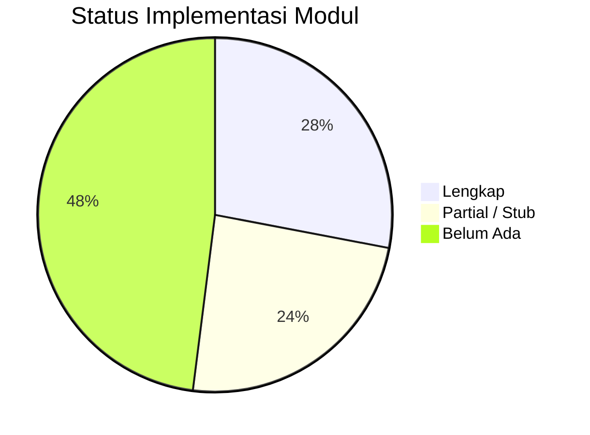
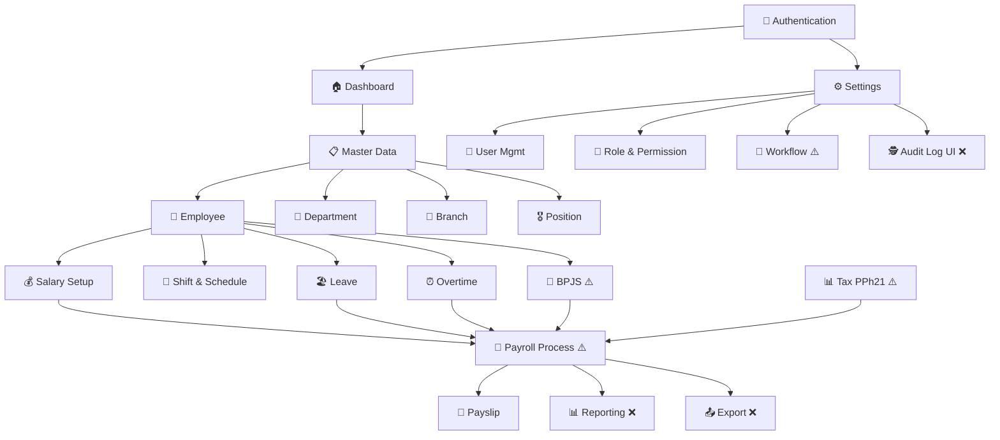

# 📊 Analisa Modul — MiniPayroll (App.UI.Web)

> **Tanggal Analisa:** 15 November 2026  
> **Project:** MiniPayroll — ASP.NET Core MVC (.NET 10)  
> **Arsitektur:** Clean Architecture (Domain → Application → Infrastructure → UI.Web)

---

## 🏗️ Struktur Project

```
MiniPayroll/App/
├── App.Domain          → Entities, DTOs, Enums, Helpers
├── App.Application     → Interfaces (Services, Repositories)
├── App.Infrastructure  → Implementasi Services, DbContext, Extensions
└── App.UI.Web          → Controllers, Views, Models (MVC Frontend)
```

---

## ✅ Modul yang ADA di Project

### 1. 🔐 Modul Authentication & Account
| Komponen | Status |
|---|---|
| Login (username/password) | ✅ Lengkap |
| Logout | ✅ Lengkap |
| MFA / OTP (UI ada, logic stub) | ⚠️ Partial |
| Cookie-based Auth | ✅ Lengkap |
| JWT Service | ✅ Ada di Infrastructure |

**Controller:** `AccountController.cs`  
**Views:** `Account/Login.cshtml`, `Account/Index.cshtml`, `Account/Mfa.cshtml`

---

### 2. 👥 Modul Master Karyawan (Employee Master)
| Komponen | Status |
|---|---|
| Data Karyawan (CRUD) | ✅ Lengkap |
| Manajemen Karyawan (tab view) | ✅ Lengkap |
| Jabatan / Position | ✅ Lengkap |
| Departemen | ✅ Lengkap |
| Cabang / Branch | ✅ Lengkap |
| PTKP (Pajak) | ✅ Lengkap |
| Profil Perusahaan | ✅ Lengkap |

**Controllers:** `EmployeeController`, `EmployeeManagementController`, `PositionController`, `DepartmentController`, `BranchController`, `ProfileController`  
**Domain Models:** `TblEmployee`, `TblDepartment`, `TblBranch`, `TblPosition`, `TblPtkp`, `TblCompanyProfile`

---

### 3. 💰 Modul Komponen Gaji (Salary Component)
| Komponen | Status |
|---|---|
| Komponen Gaji (Allowance/Deduction) | ✅ Lengkap |
| Gaji Karyawan (Employee Salary) | ✅ Lengkap |
| Detail Gaji Karyawan | ✅ Lengkap |

**Controllers:** `SalaryComponentController`, `EmployeeSalaryController`  
**Domain Models:** `TblSalaryComponent`, `TblEmployeeSalary`, `TblEmployeeSalaryDetail`, `TblAllowance`, `TblDeduction`

---

### 4. 🕐 Modul Absensi (Attendance)
| Komponen | Status |
|---|---|
| Input & List Absensi | ✅ Lengkap |
| Konfigurasi Absensi | ✅ Lengkap |
| Status Absensi | ✅ Ada (Enum + Entity) |
| View Jadwal Bulanan Karyawan | ✅ Ada (VwEmployeeMonthlySchedule) |

**Controller:** `AttendanceController`  
**Views:** `Attendance/Index.cshtml`, `Attendance/Configuration.cshtml`  
**Domain Models:** `TblAttendance`, `TblAttendanceStatus`, `VwAttendance`

---

### 5. 📅 Modul Shift & Jadwal
| Komponen | Status |
|---|---|
| Master Shift | ✅ Lengkap |
| Pola Shift (Shift Pattern) | ✅ Lengkap |
| Detail Pola Shift | ✅ Lengkap |
| Penjadwalan Shift Karyawan | ✅ Lengkap |
| Generate Jadwal | ✅ Lengkap |

**Controllers:** `ShiftController`, `PatternController`, `ScheduleController`  
**Domain Models:** `TblShift`, `TblShiftPattern`, `TblShiftPatternDetail`, `TblEmployeeShift`, `TblEmployeeShiftSchedule`

---

### 6. 🏖️ Modul Cuti (Leave)
| Komponen | Status |
|---|---|
| Jenis Cuti | ✅ Lengkap |
| Pengajuan Cuti | ✅ Lengkap |
| Approval Cuti | ✅ Lengkap |

**Controllers:** `LeaveTypeController`, `LeaveRequestController`, `LeaveApprovalController`  
**Views:** `LeaveType/`, `LeaveRequest/`, `LeaveApproval/`  
**Domain Models:** `TblLeaveType`, `TblLeaveRequest`, `VwLeaveRequest`

---

### 7. ⏰ Modul Lembur (Overtime)
| Komponen | Status |
|---|---|
| Jenis Lembur | ✅ Lengkap |
| View Overtime (UI placeholder) | ⚠️ Partial — view kosong, tidak ada controller |
| Kalkulasi Lembur | ✅ Ada di Domain (TblOvertimeCalculation, TblOvertimeRate) |
| OvertimeService | ✅ Ada di Infrastructure |

**Controller:** `OvertimeTypeController` (hanya jenis lembur)  
**Domain Models:** `TblOvertime`, `TblOvertimeCalculation`, `TblOvertimeRate`, `TblOvertimeType`

> [!WARNING]
> `Views/Overtime/Index.cshtml` ada tapi isinya **kosong** dan tidak ada `OvertimeController` yang mengelola data lembur karyawan.

---

### 8. 💸 Modul Payroll
| Komponen | Status |
|---|---|
| Payroll Period | ✅ Ada di Domain |
| Payroll Run / Process | ⚠️ Partial — view ada, controller minimal |
| Payroll Result | ✅ Ada di Domain |
| Payslip (Slip Gaji) | ✅ Lengkap |
| Payroll Policy | ✅ Ada di Domain |

**Controllers:** `PayrollController` (minimal), `PayslipController` (lengkap)  
**Views:** `Payroll/Index.cshtml`, `Payroll/Proccess.cshtml`, `Payroll/Payslip.cshtml`  
**Domain Models:** `TblPayroll`, `TblPayrollDetail`, `TblPayrollPeriod`, `TblPayrollRun`, `TblPayrollResult`, `TblPayrollResultDetail`, `TblPayrollPolicy`, `TblPayslip`

> [!WARNING]
> `PayrollController` belum menggunakan service — action `Index`, `Payslip`, `Proccess` hanya return View tanpa data.

---

### 9. 🏥 Modul BPJS
| Komponen | Status |
|---|---|
| Konfigurasi BPJS Kesehatan | ✅ Ada di Domain |
| Konfigurasi BPJS Ketenagakerjaan | ✅ Ada di Domain |
| View BPJS | ⚠️ Placeholder kosong |
| Controller BPJS | ❌ Tidak ada |

**Domain Models:** `TblBpjskesehatanConfig`, `TblBpjsketenagakerjaanConfig`

> [!WARNING]
> `Views/BPJS/Index.cshtml` isinya kosong dan tidak ada `BpjsController`.

---

### 10. 📊 Modul Pajak PPh 21
| Komponen | Status |
|---|---|
| Bracket PPh 21 | ✅ Ada di Domain |
| PTKP | ✅ Lengkap (service + controller) |
| Biaya Jabatan Config | ✅ Ada di Domain |
| View Tax | ⚠️ Placeholder kosong |
| Controller Tax | ❌ Tidak ada |

**Domain Models:** `TblPph21Bracket`, `TblPtkp`, `TblBiayaJabatanConfig`, `TaxBracket`

---

### 11. ⚙️ Modul Pengaturan (Settings)
| Komponen | Status |
|---|---|
| Manajemen User | ✅ Lengkap |
| Role & Permission | ✅ Lengkap |
| Menu Management | ✅ Ada di Domain & Service |
| Workflow (Approval flow) | ⚠️ Stub kosong |

**Controllers:** `UserController`, `RoleController`, `WorkflowController`  
**Views:** `User/`, `Role/Index.cshtml`, `Role/AccessPermission.cshtml`

---

### 12. 🏠 Modul Dashboard / Home
| Komponen | Status |
|---|---|
| Dashboard (Home) | ⚠️ Partial |
| Reporting (placeholder) | ⚠️ Placeholder kosong |
| Audit Log | ✅ Ada di Domain (TblAuditLog) |

**Controller:** `HomeController`  
**Views:** `Home/Index.cshtml`, `Reporting/Index.cshtml`

---

## ❌ Modul yang BELUM ADA / Kurang

### Modul Belum Terimplementasi (View + Controller Kosong)

| No | Modul | Keterangan |
|---|---|---|
| 1 | **BPJS Management** | View placeholder kosong, tidak ada controller, tidak ada service interface |
| 2 | **Pajak PPh 21 (Tax)** | View placeholder kosong, tidak ada controller untuk kelola bracket & konfigurasi |
| 3 | **Overtime Karyawan** | Tidak ada controller untuk input/approval/list lembur karyawan (hanya jenis lembur) |
| 4 | **Payroll Processing** | `PayrollController` belum menggunakan service, belum ada logika proses payroll di UI |
| 5 | **Reporting / Laporan** | View placeholder kosong, tidak ada controller, tidak ada modul laporan sama sekali |
| 6 | **Workflow Approval** | `WorkflowController` hanya scaffold kosong, belum ada logic approval chain |

---

### Modul yang Sama Sekali Belum Ada

| No | Modul | Alasan Dibutuhkan |
|---|---|---|
| 7 | **📧 Notifikasi (Email/Notif)** | `EmailService` sudah ada di Infrastructure tapi tidak ada UI/trigger untuk notifikasi |
| 8 | **🔑 Reset Password / Manajemen Password** | Tidak ada fitur forgot password, change password dari dalam aplikasi |
| 9 | **📥 Import Data (Excel/CSV)** | Tidak ada fitur import massal karyawan, absensi, atau gaji |
| 10 | **📤 Export Laporan (Excel/PDF)** | Library jszip & pdfmake sudah ada di wwwroot tapi belum ada endpoint export |
| 11 | **🕵️ Audit Trail UI** | `TblAuditLog` ada di Domain tapi tidak ada UI untuk melihat log aktivitas |
| 12 | **📆 Payroll Period Management UI** | `TblPayrollPeriod` ada di Domain tapi tidak ada controller/view untuk kelola periode |
| 13 | **🧾 Reimbursement / Klaim** | Tidak ada modul klaim biaya/reimbursement karyawan |
| 14 | **🎯 KPI / Performance** | Tidak ada modul penilaian kinerja karyawan |
| 15 | **📱 Self-Service Karyawan (ESS)** | Tidak ada portal mandiri bagi karyawan untuk lihat slip gaji, cek cuti sendiri |
| 16 | **🏦 Rekening Bank Karyawan** | Tidak ada field/modul untuk data rekening bank karyawan (diperlukan transfer gaji) |
| 17 | **📋 Kontrak Kerja** | Tidak ada modul pengelolaan kontrak/PKWT karyawan |
| 18 | **🔔 MFA yang Fungsional** | UI MFA ada namun `VerifyOtp()` adalah stub (`return true`) — tidak benar-benar aman |

---

## 📌 Ringkasan Status Modul



| Kategori | Jumlah | Contoh |
|---|---|---|
| ✅ **Lengkap** | 7 | Auth, Employee, Leave, Shift, Salary Component, Role, Payslip |
| ⚠️ **Partial / Stub** | 6 | BPJS, Tax, Overtime, Payroll Process, Reporting, Workflow |
| ❌ **Belum Ada** | 12 | Import/Export, ESS, Audit UI, Reset Password, Notifikasi, dll |

---

## 🗺️ Peta Ketergantungan Modul



> **Legenda:** ✅ Lengkap &nbsp;|&nbsp; ⚠️ Partial &nbsp;|&nbsp; ❌ Belum Ada

---

*Dokumen ini dibuat secara otomatis berdasarkan analisa source code project MiniPayroll pada tanggal 15 November 2026.*

