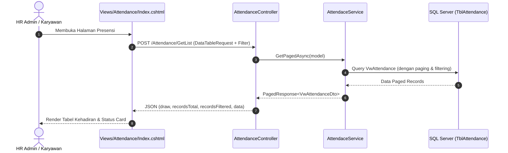

# 📅 Modul: Attendance (Presensi & Kehadiran)

## 1. Ringkasan & Tujuan
Modul **Attendance** bertanggung jawab untuk mencatat, mengelola, dan memonitor data kehadiran seluruh karyawan setiap hari. Modul ini menjadi input primer bagi perhitungan lembur (*Overtime*), potongan kehadiran (*Late / Early Out Deduction*), dan kalkulasi penggajian bulanan (*Payroll Process*).

---

## 2. Struktur Komponen & File Terkait

```text
Attendance Module
├── UI (Views)
│   ├── Views/Attendance/Index.cshtml           # Tampilan tabel data presensi & filter
│   └── Views/Attendance/Configuration.cshtml   # Konfigurasi menu/sub-aturan presensi
├── Controller
│   └── Controllers/AttendanceController.cs     # Endpoints HTTP & integrasi DataTable
├── Application (Contracts)
│   └── Interfaces/Services/Attendance/IAttendanceService.cs
├── Infrastructure (Business Logic)
│   └── Services/Attendance/AttendaceService.cs # Query paging, penyimpanan, kalkulasi menit kerja
└── Domain (Entities & Models)
    ├── Entities/TblAttendance.cs               # Entity tabel absensi
    ├── Entities/TblAttendanceStatus.cs         # Master status absensi (Hadir, Izin, Sakit, Alpa)
    ├── Models/Dto/Attendance/AttendanceDto.cs
    └── Models/Dto/Attendance/VwAttendanceDto.cs
```

---

## 3. Alur Kerja (Workflow)



---

## 4. Struktur Data Kunci (`TblAttendance`)

| Field | Tipe Data | Deskripsi |
| :--- | :--- | :--- |
| `AttendanceId` | `int` (PK) | Identifier unik baris kehadiran. |
| `EmployeeId` | `int` (FK) | Relasi ke karyawan (`TblEmployee`). |
| `AttendanceDate` | `DateOnly` | Tanggal catatan presensi. |
| `ShiftId` | `int?` (FK) | Shift kerja yang dijadwalkan (`TblShift`). |
| `ScheduledTimeIn` | `TimeOnly?` | Jam masuk yang dijadwalkan (dari Shift). |
| `ScheduledTimeOut` | `TimeOnly?` | Jam pulang yang dijadwalkan (dari Shift). |
| `ActualTimeIn` | `TimeOnly?` | Jam aktual karyawan melakukan *Clock In*. |
| `ActualTimeOut` | `TimeOnly?` | Jam aktual karyawan melakukan *Clock Out*. |
| `LateMinutes` | `int` | Keterlambatan dalam menit (jika aktual masuk > jadwal). |
| `EarlyOutMinutes` | `int` | Pulang lebih awal dalam menit (jika aktual pulang < jadwal). |
| `WorkMinutes` | `int` | Total durasi jam kerja produktif (menit). |
| `OvertimeMinutes`| `int` | Kelebihan waktu kerja yang dihitung sebagai lembur. |
| `AttendanceStatus`| `string` | Status: `Present`, `Late`, `Absent`, `Leave`, `Holiday`. |
| `IsManualEntry` | `bool` | Penanda jika data di-input secara manual oleh HR. |

---

## 5. Endpoints Utama (`AttendanceController`)

| Endpoint | Method | Keterangan |
| :--- | :---: | :--- |
| `/Attendance` atau `/Attendance/Index` | `GET` | Membuka antarmuka utama tabel presensi. |
| `/Attendance/Configuration` | `GET` | Halaman konfigurasi terkait menu presensi (Parent: `ATT004`). |
| `/Attendance/GetList` | `POST` | Endpoint server-side data fetching untuk jQuery DataTables. |
| `/Attendance/Save` | `POST` | Menyimpan entri kehadiran baru atau update data yang ada. |
| `/Attendance/Delete` | `POST` | Menghapus entri presensi berdasarkan ID. |

---

## 6. Daftar Tugas Pengembangan & Instruksi (*Action Items*)

Berdasarkan analisa kode pada `Index.cshtml` dan catatan instruksi pengembangan:

- [ ] **1. Perbaikan Filter DataTable**: Filter pencarian (tanggal dari/sampai, status, department) belum memfilter query DataTable dengan tepat. Perlu integrasi payload request ke controller.
- [ ] **2. Integrasi Dropdown Department**: Mengisi opsi `#DepartmentSelect` dari data master departemen yang ada di database secara dinamis.
- [ ] **3. Integrasi Dropdown Status**: Mengisi opsi `#StatusSelect` dari data master `TblAttendanceStatus`.
- [ ] **4. Integrasi Dropdown Employee**: Mengisi opsi dropdown karyawan dari data aktif `TblEmployee`.
- [ ] **5. Modernisasi UI**: Mengadopsi palet warna cerah (*light color scheme*), card summary metrik (Total Employee, Present, Late, Absent, Leave) yang bersih dan responsif.

