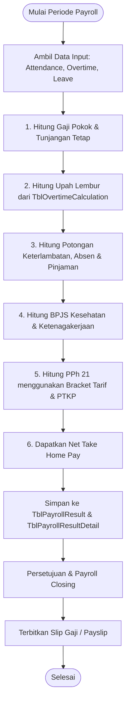

# 💰 Modul: Payroll & Payslip (Penggajian & Slip Gaji)

## 1. Ringkasan & Tujuan
Modul **Payroll & Payslip** adalah inti dari sistem MiniPayroll. Modul ini menangani:
1. Pengaturan gaji pokok & struktur penghasilan karyawan (*Employee Salary*).
2. Pemrosesan kalkulasi penggajian bulanan (*Payroll Process / Run*).
3. Penerapan formula kompensasi: Gaji Pokok + Tunjangan + Upah Lembur - Potongan - BPJS - PPh 21.
4. Finalisasi (*Payroll Closing*) dan pencetakan/distribusi slip gaji karyawan (*Payslip*).

---

## 2. Struktur Komponen & File Terkait

```text
Payroll Module
├── Controllers
│   ├── Controllers/PayrollController.cs        # Navigasi proses payroll & closing
│   ├── Controllers/PayslipController.cs        # Manajemen & pencarian slip gaji
│   └── Controllers/EmployeeSalaryController.cs # Pengaturan gaji per karyawan
├── Services & Calculation Engine
│   ├── Infrastructure/Services/Payroll/PayrollService.cs   # Mesin hitung komprehensif
│   ├── Infrastructure/Services/Masters/EmployeeSalaryService.cs
│   └── Application/Interfaces/Services/Payroll/IPayslipService.cs
└── Domain (Entities & Models)
    ├── Entities/TblPayrollRun.cs               # Header eksekusi periode penggajian
    ├── Entities/TblPayrollResult.cs            # Ringkasan gaji per karyawan dalam run
    ├── Entities/TblPayrollResultDetail.cs      # Rincian item per baris (komponen)
    ├── Entities/TblEmployeePayroll.cs          # Mapping payroll ke karyawan
    ├── Entities/TblEmployeeSalary.cs           # Master base salary karyawan
    ├── Entities/TblPayslip.cs                  # Dokumen slip gaji terbit
    └── Models/Dto/Payroll/PayslipDto.cs
```

---

## 3. Alur Perhitungan Payroll (*Calculation Flow*)



---

## 4. Formula Komponen Perhitungan

$$
\text{Gross Income} = \text{Gaji Pokok} + \sum \text{Tunjangan} + \text{Upah Lembur} + \text{BPJS Dibayar Perusahaan}
$$

$$
\text{Total Potongan} = \sum \text{Potongan} + \text{BPJS Porsi Karyawan} + \text{PPh 21} + \text{Potongan Absensi}
$$

$$
\text{Take Home Pay (THP)} = \text{Gross Income} - \text{Total Potongan}
$$

---

## 5. Endpoints Utama

| Controller | Route | Method | Keterangan |
| :--- | :--- | :---: | :--- |
| `PayrollController` | `/Payroll` | `GET` | Dashboard utama modul payroll. |
| `PayrollController` | `/Payroll/Proccess` | `GET` / `POST` | Menjalankan kalkulasi penggajian periode berjalan. |
| `PayrollController` | `/Payroll/Payslip/{id}` | `GET` | Melihat preview slip gaji sebelum rilis. |
| `PayslipController` | `/Payslip` | `GET` | Daftar seluruh slip gaji karyawan. |
| `PayslipController` | `/Payslip/GetList` | `POST` | DataTables endpoint slip gaji. |
| `PayslipController` | `/Payslip/Info/{id}` | `GET` | Detail rincian slip gaji untuk cetak / export PDF. |
| `EmployeeSalaryController` | `/EmployeeSalary` | `GET` | Master penetapan gaji pokok dan tunjangan karyawan. |

---

## 6. Integrasi dengan Modul Lain
- **Modul Attendance**: Menghitung potongan keterlambatan (*LateMinutes*) dan potongan mangkir (*Absent*).
- **Modul Overtime**: Menghitung jam lembur terverifikasi dikalikan tarif upah per jam.
- **Modul Salary Components & Tax**: Mengambil parameter persentase BPJS, batas plafon, dan batasan tarif PPh 21.

