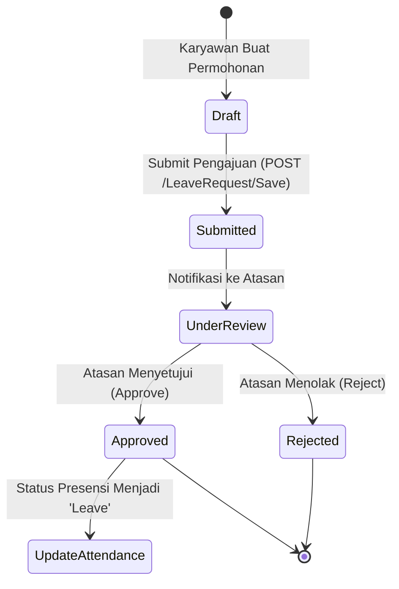

# 🏖️ Modul: Leave Management (Cuti & Izin)

## 1. Ringkasan & Tujuan
Modul **Leave Management** menangani siklus hidup pengajuan izin dan cuti kerja karyawan:
1. **Master Jenis Cuti (`LeaveType`)**: Pengaturan cuti tahunan, cuti melahirkan, cuti menikah, izin duka, dan izin sakit (berbayar vs tidak berbayar / unpaid leave).
2. **Pengajuan Cuti (`LeaveRequest`)**: Karyawan atau HR mengajukan permohonan tanggal cuti beserta alasan dan lampiran dokumen pendukung.
3. **Persetujuan Cuti (`LeaveApproval`)**: Alur persetujuan oleh atasan langsung / HR Manager sebelum memotong kuota cuti atau mempengaruhi absensi.

---

## 2. Struktur Komponen & File Terkait

```text
Leave Module
├── Controllers
│   ├── Controllers/LeaveRequestController.cs   # Pengajuan & monitoring cuti
│   ├── Controllers/LeaveApprovalController.cs  # Aksi approval / reject cuti
│   └── Controllers/LeaveTypeController.cs      # Master data jenis & kuota cuti
├── Services
│   ├── Application/Interfaces/Services/Leave/ILeaveService.cs
│   ├── Infrastructure/Services/Leave/LeaveService.cs
│   ├── Application/Interfaces/Services/Masters/ILeaveTypeService.cs
│   └── Infrastructure/Services/Masters/LeaveTypeService.cs
└── Domain (Entities & Models)
    ├── Entities/TblLeaveRequest.cs             # Transaksi pengajuan cuti
    ├── Entities/TblLeaveType.cs                # Definisi master jenis cuti
    ├── Entities/VwLeaveRequest.cs              # View SQL agregasi cuti
    └── Models/Dto/Leave/LeaveDto.cs
```

---

## 3. Alur Pengajuan & Persetujuan Cuti



---

## 4. Struktur Data Kunci (`TblLeaveRequest`)

| Field | Tipe Data | Keterangan |
| :--- | :--- | :--- |
| `LeaveRequestId` | `long` (PK) | ID transaksi pengajuan cuti. |
| `EmployeeId` | `int` (FK) | Relasi ke karyawan pemohon. |
| `LeaveTypeId` | `int` (FK) | Jenis cuti yang diambil (`TblLeaveType`). |
| `StartDate` | `DateOnly` | Tanggal awal cuti. |
| `EndDate` | `DateOnly` | Tanggal akhir cuti. |
| `TotalDays` | `decimal` | Jumlah hari kerja yang terpotong. |
| `Reason` | `string` | Alasan permohonan cuti. |
| `ApprovalStatus` | `string` | Status: `Pending`, `Approved`, `Rejected`. |
| `ApprovedBy` | `string` | User ID atasan yang menyetujui. |
| `ApprovedDate` | `DateTime?` | Waktu persetujuan diberikan. |

---

## 5. Endpoints Utama

| Controller | Route | Method | Keterangan |
| :--- | :--- | :---: | :--- |
| `LeaveRequestController` | `/LeaveRequest` | `GET` | Halaman daftar permohonan cuti. |
| `LeaveRequestController` | `/LeaveRequest/GetList` | `POST` | DataTables endpoint riwayat pengajuan cuti. |
| `LeaveRequestController` | `/LeaveRequest/Save` | `POST` | Menyimpan pengajuan permohonan cuti baru. |
| `LeaveRequestController` | `/LeaveRequest/Delete` | `POST` | Membatalkan/menghapus pengajuan cuti. |
| `LeaveApprovalController`| `/LeaveApproval` | `GET` | Antarmuka approval untuk manajer / HR. |
| `LeaveTypeController` | `/LeaveType` | `GET` | Master data konfigurasi kategori cuti. |

