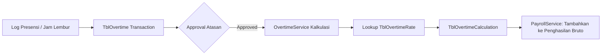

# ⏱️ Modul: Overtime Management (Lembur Karyawan)

## 1. Ringkasan & Tujuan
Modul **Overtime Management** mengelola pencatatan jam kerja lembur karyawan, penentuan tarif lembur berdasarkan regulasi ketenagakerjaan (Depnaker), dan kalkulasi otomatis nominal upah lembur yang akan dibayarkan melalui modul Payroll.

---

## 2. Struktur Komponen & File Terkait

```text
Overtime Module
├── UI (Views)
│   ├── Views/Overtime/Index.cshtml             # Riwayat & rekapitulasi lembur
│   └── Views/OvertimeType/Index.cshtml         # Master tipe lembur (hari kerja vs libur)
├── Controllers
│   └── Controllers/OvertimeTypeController.cs   # Kelola master jenis lembur
├── Services
│   ├── Application/Interfaces/Services/Masters/IOvertimeTypeService.cs
│   ├── Infrastructure/Services/Masters/OvertimeTypeService.cs
│   └── Infrastructure/Services/Payroll/OvertimeService.cs      # Mesin kalkulasi rate lembur
└── Domain (Entities & Models)
    ├── Entities/TblOvertime.cs                 # Catatan transaksi lembur
    ├── Entities/TblOvertimeType.cs             # Jenis lembur (Weekday, Weekend, Holiday)
    ├── Entities/TblOvertimeRate.cs             # Pengali upah per jam lembur (1.5x, 2x, 3x, 4x)
    └── Entities/TblOvertimeCalculation.cs      # Hasil hitung nominal upah lembur
```

---

## 3. Rumus & Aturan Regulasi Lembur (Kemenaker)

Upah lembur per jam dihitung dengan formula standar:

$$
\text{Upah Lembur per Jam} = \frac{1}{173} \times \text{Upah Sebulan (Gaji Pokok + Tunjangan Tetap)}
$$

### Skema Pengali Jam Lembur:
1. **Hari Kerja Normal**:
   - Jam pertama: **$1.5 \times$** upah per jam.
   - Jam kedua dan seterusnya: **$2.0 \times$** upah per jam.
2. **Hari Libur Resmi / Istirahat Mingguan**:
   - Jam ke-1 s.d ke-7 / ke-8: **$2.0 \times$** upah per jam.
   - Jam ke-8 / ke-9: **$3.0 \times$** upah per jam.
   - Jam ke-10 dan seterusnya: **$4.0 \times$** upah per jam.

---

## 4. Alur Integrasi Lembur ke Penggajian



---

## 5. Endpoints Utama

| Controller | Route | Method | Keterangan |
| :--- | :--- | :---: | :--- |
| `OvertimeTypeController` | `/OvertimeType` | `GET` | Menampilkan tabel master jenis lembur. |
| `OvertimeTypeController` | `/OvertimeType/GetList` | `POST` | DataTables endpoint master tipe lembur. |
| `OvertimeTypeController` | `/OvertimeType/Save` | `POST` | Simpan/ubah master tipe lembur. |
| `OvertimeTypeController` | `/OvertimeType/Delete` | `POST` | Hapus master tipe lembur. |
| `Views/Overtime/Index` | `/Overtime` | `GET` | Dashboard monitoring transaksi lembur karyawan. |

