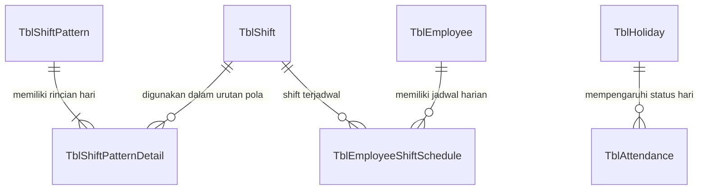

# 🕒 Modul: Shift & Schedule Management (Jadwal Kerja & Hari Libur)

## 1. Ringkasan & Tujuan
Modul **Shift & Schedule** mengatur seluruh parameter waktu kerja operasional perusahaan:
1. **Master Shift (`TblShift`)**: Jam masuk, jam pulang, toleransi keterlambatan, dan jam istirahat (contoh: Shift Pagi, Shift Siang, Shift Malam, Non-Shift).
2. **Pola Shift (`Shift Pattern`)**: Siklus perputaran shift mingguan atau berulang (misal: 6 hari kerja 1 hari libur, atau rotasi Shift 1 - Shift 2 - Off).
3. **Penjadwalan Karyawan (`Schedule / Roster`)**: Alokasi jadwal shift bulanan ke masing-masing karyawan.
4. **Hari Libur Nasional (`Holiday`)**: Kalender tanggal merah dan cuti bersama yang dikecualikan dari potongan mangkir/alpa.

---

## 2. Struktur Komponen & File Terkait

```text
Shift & Schedule Module
├── Controllers
│   ├── Controllers/ShiftController.cs          # CRUD Shift jam kerja
│   ├── Controllers/PatternController.cs        # Pengaturan pola rotasi shift
│   ├── Controllers/ScheduleController.cs       # Roster penugasan jadwal karyawan
│   └── Controllers/HolidayController.cs        # Kalender hari libur nasional
├── Services
│   ├── Application/Interfaces/Services/Masters/IShiftService.cs
│   ├── Application/Interfaces/Services/Masters/IShiftPatternService.cs
│   ├── Application/Interfaces/Services/Masters/IHolidayService.cs
│   ├── Infrastructure/Services/Masters/ShiftService.cs
│   └── Infrastructure/Services/Masters/ShiftPatternService.cs
└── Domain (Entities & Views)
    ├── Entities/TblShift.cs                    # Definisi jam masuk & jam keluar
    ├── Entities/TblShiftPattern.cs             # Header pola rotasi shift
    ├── Entities/TblShiftPatternDetail.cs       # Rincian urutan hari dalam pola
    ├── Entities/TblEmployeeShiftSchedule.cs    # Jadwal aktual per tanggal karyawan
    ├── Entities/TblHoliday.cs                  # Daftar hari libur
    └── Entities/VwEmployeeMonthlySchedule.cs   # View SQL jadwal bulanan
```

---

## 3. Relasi Konsep Shift & Roster



---

## 4. Struktur Data Kunci (`TblShift`)

| Field | Tipe Data | Keterangan |
| :--- | :--- | :--- |
| `ShiftId` | `int` (PK) | Identifier unik shift. |
| `ShiftName` | `string` | Nama shift (misal: `Shift Pagi 08:00 - 17:00`). |
| `StartTime` | `TimeOnly` | Waktu jam masuk wajib. |
| `EndTime` | `TimeOnly` | Waktu jam pulang wajib. |
| `GracePeriodMinutes` | `int` | Menit toleransi keterlambatan tanpa penalti. |
| `BreakDurationMinutes` | `int` | Durasi istirahat yang tidak dihitung jam kerja. |
| `IsOvernight` | `bool` | True jika shift melewati pergantian hari (misal 22:00 - 06:00). |

---

## 5. Endpoints Utama

| Controller | Route | Method | Keterangan |
| :--- | :--- | :---: | :--- |
| `ShiftController` | `/Shift` | `GET` | Halaman kelola data master shift. |
| `ShiftController` | `/Shift/GetList` | `POST` | DataTables endpoint daftar shift. |
| `PatternController` | `/Pattern` | `GET` | Halaman konfigurasi pola siklus shift. |
| `ScheduleController` | `/Schedule` | `GET` | Antarmuka pembuatan dan monitoring roster jadwal kerja. |
| `HolidayController` | `/Holiday` | `GET` | Pengaturan kalender libur nasional & cuti bersama. |

