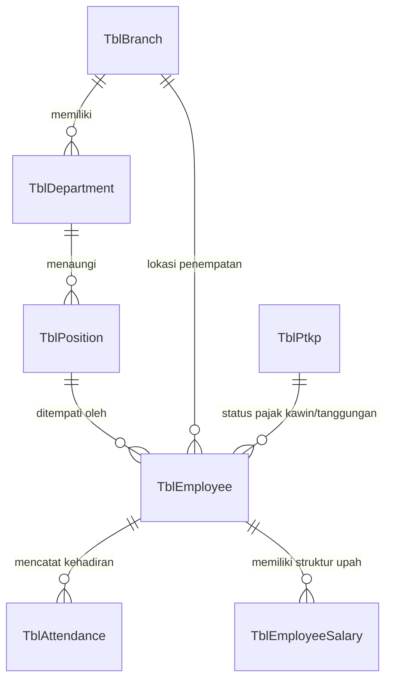

# 👥 Modul: Employee & Organization Master (Karyawan & Struktur Organisasi)

## 1. Ringkasan & Tujuan
Modul **Employee & Organization Master** merupakan fondasi data seluruh karyawan dan hierarki perusahaan:
1. **Data Karyawan (`Employee`)**: Profil pribadi, NIK/NIP, tanggal bergabung, status pernikahan/tanggungan keluarga (PTKP), nomor rekening bank gaji, dan status kepegawaian (Tetap, Kontrak, Probasi, Magang).
2. **Struktur Organisasi**: Pembagian hierarki berdasarkan Cabang (*Branch*), Departemen (*Department*), dan Jabatan (*Position*).
3. **Profil Perusahaan (`Company Profile`)**: Identitas entitas legal perusahaan, NPWP perusahaan, alamat kantor pusat, dan konfigurasi umum.

---

## 2. Struktur Komponen & File Terkait

```text
Employee & Organization Module
├── Controllers
│   ├── Controllers/EmployeeController.cs           # CRUD & DataTables karyawan
│   ├── Controllers/EmployeeManagementController.cs # Pengelolaan status & lifecycle kerja
│   ├── Controllers/DepartmentController.cs         # Master Departemen
│   ├── Controllers/PositionController.cs           # Master Jabatan
│   ├── Controllers/BranchController.cs             # Master Kantor Cabang
│   └── Controllers/ProfileController.cs            # Pengaturan profil perusahaan
├── Services
│   ├── Application/Interfaces/Services/Masters/IEmployeeService.cs
│   ├── Application/Interfaces/Services/Masters/IDepartmentService.cs
│   ├── Application/Interfaces/Services/Masters/IPositionService.cs
│   ├── Application/Interfaces/Services/Masters/IBranchService.cs
│   └── Application/Interfaces/Services/Masters/IProfileService.cs
└── Domain (Entities)
    ├── Entities/TblEmployee.cs                     # Master biodata karyawan
    ├── Entities/TblDepartment.cs                   # Entitas departemen
    ├── Entities/TblPosition.cs                     # Entitas jabatan
    ├── Entities/TblBranch.cs                       # Entitas kantor cabang
    └── Entities/TblCompanyProfile.cs               # Entitas profil perusahaan
```

---

## 3. Diagram Hubungan Struktur Organisasi (ERD)



---

## 4. Struktur Data Kunci (`TblEmployee`)

| Field | Tipe Data | Deskripsi |
| :--- | :--- | :--- |
| `EmployeeId` | `int` (PK) | Identifier numerik karyawan. |
| `EmployeeCode` | `string` | Nomor Induk Karyawan (NIK / NIP). |
| `FullName` | `string` | Nama lengkap karyawan. |
| `DepartmentId` | `int` (FK) | Relasi ke `TblDepartment`. |
| `PositionId` | `int` (FK) | Relasi ke `TblPosition`. |
| `BranchId` | `int` (FK) | Relasi ke `TblBranch`. |
| `PtkpId` | `int` (FK) | Relasi ke kategori PTKP pajak (`TK/0`, `K/1`, dll). |
| `JoinDate` | `DateOnly` | Tanggal resmi mulai bekerja. |
| `ResignDate` | `DateOnly?` | Tanggal pengunduran diri / non-aktif. |
| `EmploymentStatus` | `string` | `Permanent`, `Contract`, `Probation`, `Intern`. |
| `IsActive` | `bool` | Status keaktifan dalam sistem. |

---

## 5. Endpoints Utama

| Controller | Route | Method | Keterangan |
| :--- | :--- | :---: | :--- |
| `EmployeeController` | `/Employee` | `GET` | Halaman daftar data karyawan. |
| `EmployeeController` | `/Employee/GetEmployees`| `POST` | DataTables endpoint daftar karyawan. |
| `DepartmentController` | `/Department` | `GET` | Halaman kelola master departemen. |
| `PositionController` | `/Position` | `GET` | Halaman kelola data master jabatan. |
| `BranchController` | `/Branch` | `GET` | Halaman kelola data kantor cabang. |
| `ProfileController` | `/Profile` | `GET` | Halaman informasi profil perusahaan. |

