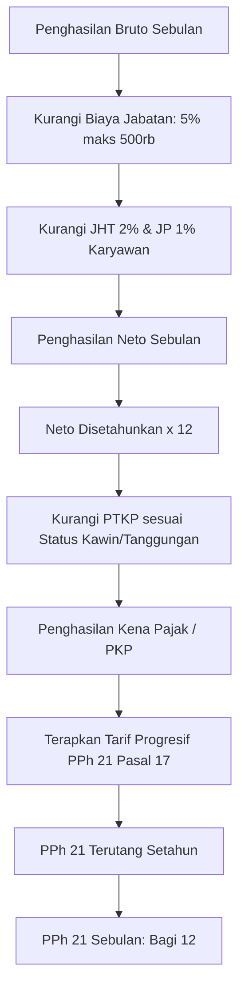

# 💳 Modul: Salary Components, Tax & BPJS (Komponen Gaji, BPJS & Pajak)

## 1. Ringkasan & Tujuan
Modul **Salary Components, Tax & BPJS** mengatur parameter perhitungan finansial dan kepatuhan perpajakan/asuransi sesuai undang-undang ketenagakerjaan Indonesia:
1. **Komponen Pendapatan & Potongan**: Tunjangan tetap (Transport, Makan, Jabatan), tunjangan tidak tetap, dan potongan resmi (Pinjaman, Denda).
2. **BPJS Kesehatan**: Iuran $5\%$ (4% ditanggung perusahaan, 1% ditanggung karyawan) dengan batas batas upah maksimal (*capping*).
3. **BPJS Ketenagakerjaan**: Program JKK (Jaminan Kecelakaan Kerja), JKM (Kematian), JHT (Hari Tua 3.7% perusahaan + 2% karyawan), dan JP (Pensiun 2% perusahaan + 1% karyawan).
4. **Pajak Penghasilan (PPh 21)**: Pengurangan Biaya Jabatan ($5\%$ maks Rp 500.000/bulan atau Rp 6.000.000/tahun), nilai PTKP (TK/0 s.d K/3), dan lapisan tarif progresif (Bracket 5%, 15%, 25%, 30%, 35%).

---

## 2. Struktur Komponen & File Terkait

```text
Salary Components & Tax Module
├── Controllers
│   └── Controllers/SalaryComponentController.cs    # Kelola master komponen gaji
├── Services
│   ├── Application/Interfaces/Services/Masters/ISalaryComponentService.cs
│   ├── Application/Interfaces/Services/Masters/IPtkpService.cs
│   └── Infrastructure/Services/Masters/SalaryComponentService.cs
└── Domain (Entities)
    ├── Entities/TblSalaryComponent.cs              # Master jenis tunjangan/potongan
    ├── Entities/TblAllowance.cs                    # Definisi tunjangan aktif
    ├── Entities/TblDeduction.cs                    # Definisi potongan aktif
    ├── Entities/TblBpjskesehatanConfig.cs          # Persentase & plafon BPJS Kesehatan
    ├── Entities/TblBpjsketenagakerjaanConfig.cs    # Persentase JHT, JP, JKK, JKM
    ├── Entities/TblBiayaJabatanConfig.cs           # Rate & batas biaya jabatan
    ├── Entities/TblPtkp.cs                         # Nilai Penghasilan Tidak Kena Pajak
    └── Entities/TblPph21Bracket.cs                 # Lapisan tarif pajak progresif
```

---

## 3. Skema Parameter Statutory (Pajak & BPJS)



---

## 4. Struktur Data Kunci (`TblBpjsketenagakerjaanConfig`)

| Field | Tipe Data | Deskripsi |
| :--- | :--- | :--- |
| `Id` | `int` (PK) | Identifier konfigurasi. |
| `EffectiveDate` | `DateOnly` | Tanggal mulai berlakunya aturan/tarif. |
| `JhtEmployeeRate` | `decimal` | Persentase iuran JHT karyawan (umumnya 2.0%). |
| `JhtEmployerRate` | `decimal` | Persentase iuran JHT perusahaan (umumnya 3.7%). |
| `JpEmployeeRate` | `decimal` | Persentase JP karyawan (umumnya 1.0%). |
| `JpEmployerRate` | `decimal` | Persentase JP perusahaan (umumnya 2.0%). |
| `JpMaxSalaryCap` | `decimal` | Plafon batas maksimal gaji untuk JP. |
| `JkkRate` | `decimal` | Tarif JKK berdasarkan tingkat risiko lingkungan kerja. |
| `JkmRate` | `decimal` | Tarif JKM (umumnya 0.3%). |

---

## 5. Endpoints Utama

| Controller | Route | Method | Keterangan |
| :--- | :--- | :---: | :--- |
| `SalaryComponentController` | `/SalaryComponent` | `GET` | Halaman kelola komponen tunjangan dan potongan. |
| `SalaryComponentController` | `/SalaryComponent/GetList` | `POST` | DataTables endpoint master komponen gaji. |
| `SalaryComponentController` | `/SalaryComponent/Save` | `POST` | Menyimpan penambahan atau perubahan komponen gaji. |
| `Views/BPJS/Index` | `/BPJS` | `GET` | Monitoring dan setting parameter tarif BPJS. |
| `Views/Tax/Index` | `/Tax` | `GET` | Monitoring bracket tarif PPh 21 dan daftar PTKP. |

