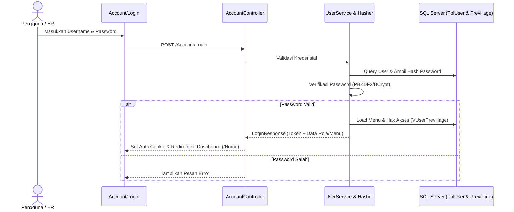

# 🔐 Modul: User & Access Security (Autentikasi, Role & Hak Akses)

## 1. Ringkasan & Tujuan
Modul **User & Access Security** menjamin keamanan data dan otorisasi akses dalam sistem MiniPayroll:
1. **Autentikasi Pengguna**: Login akun, verifikasi password ter-hash (`PasswordHasher`), refresh token, dan manajemen sesi JWT / Cookie.
2. **Manajemen Pengguna (`User`)**: Akun operator HR, admin sistem, manajer departemen, dan portal mandiri karyawan (*Employee Self-Service*).
3. **Role-Based Access Control (RBAC)**: Pengelompokan peran kerja (SuperAdmin, HR Admin, HR Payroll, Manager, Staff).
4. **Hak Akses Menu & Fitur (`Privilege`)**: Izin membaca (*View*), menambah (*Create*), mengedit (*Edit*), dan menghapus (*Delete*) untuk setiap menu yang terdaftar di `TblMenu`.

---

## 2. Struktur Komponen & File Terkait

```text
Security Module
├── Controllers
│   ├── Controllers/AccountController.cs        # Login, logout, refresh token
│   ├── Controllers/UserController.cs           # Manajemen akun pengguna
│   └── Controllers/RoleController.cs           # Manajemen peran & hak akses
├── Services
│   ├── Application/Interfaces/Services/IUserService.cs
│   ├── Application/Interfaces/Services/Settings/IRoleService.cs
│   ├── Application/Interfaces/Services/Settings/IMenuService.cs
│   ├── Application/Interfaces/Services/IJwtService.cs
│   ├── Application/Interfaces/Services/IHasherService.cs
│   └── Application/PasswordHasher.cs           # Logika enkripsi/hashing password
└── Domain (Entities & Views)
    ├── Entities/TblUser.cs                     # Master akun pengguna
    ├── Entities/Role.cs                        # Master role
    ├── Entities/Menu.cs & TblMenu.cs           # Master navigasi menu
    ├── Entities/Previllage.cs                  # Mapping permission role ke menu
    ├── Entities/VUserPrevillage.cs             # View SQL hak akses per user
    └── Entities/TblAuditLog.cs                 # Catatan log aktivitas pengguna
```

---

## 3. Alur Autentikasi & Verifikasi Hak Akses



---

## 4. Struktur Data Kunci (`TblUser`)

| Field | Tipe Data | Deskripsi |
| :--- | :--- | :--- |
| `UserId` | `string` (PK) | Username / User ID unik. |
| `EmployeeId` | `int?` (FK) | Relasi ke karyawan (jika akun terikat karyawan). |
| `PasswordHash` | `string` | Hash kata sandi terenkripsi. |
| `Email` | `string` | Alamat email user. |
| `IsActive` | `bool` | Status user aktif / suspended. |
| `RoleId` | `string` (FK) | Peran default pengguna (`Admin`, `HR`, `User`). |
| `LastLoginDate`| `DateTime?` | Rekam jejak waktu login terakhir. |

---

## 5. Endpoints Utama

| Controller | Route | Method | Keterangan |
| :--- | :--- | :---: | :--- |
| `AccountController` | `/Account/Login` | `GET` / `POST` | Halaman login & verifikasi akun pengguna. |
| `AccountController` | `/Account/Logout` | `POST` | Mengakhiri sesi dan membersihkan token. |
| `UserController` | `/User` | `GET` | Halaman kelola akun pengguna. |
| `UserController` | `/User/GetList` | `POST` | DataTables endpoint daftar pengguna. |
| `RoleController` | `/Role` | `GET` | Halaman kelola role & konfigurasi hak akses menu. |
| `RoleController` | `/Role/SavePrivilege`| `POST` | Menyimpan matriks izin menu per role. |

