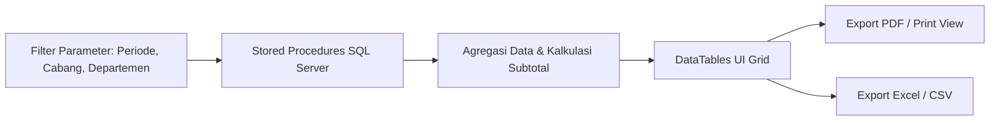

# 📊 Modul: Reports & Analytics (Pelaporan & Analisa HR)

## 1. Ringkasan & Tujuan
Modul **Reports & Analytics** menyajikan data agregasi, statistik, dan laporan cetak untuk manajemen, finance/akuntansi, dan kebutuhan audit eksternal. Modul ini terbagi menjadi 6 sub-laporan utama:

1. **Attendance Report (`RP01`)**: Rekapitulasi absensi bulanan karyawan (total hari kerja, hadir, terlambat, mangkir, izin).
2. **Leave Report (`RP02`)**: Rekapitulasi penggunaan kuota cuti karyawan dan saldo cuti tahunan yang tersisa.
3. **Overtime Report (`RP03`)**: Total jam lembur per divisi/karyawan beserta total biaya lembur yang timbul.
4. **Payroll Summary (`RP04`)**: Ringkasan total beban penggajian perusahaan per periode (Total Gaji Pokok, Tunjangan, Lembur, BPJS Perusahaan, Pajak, dan Total Pengeluaran Kas).
5. **Payroll Detail (`RP05`)**: Rincian gaji baris per baris per karyawan dalam format tabel komprehensif.
6. **Payslip Report (`RP06`)**: Rekapitulasi slip gaji karyawan yang siap dicetak massal atau diekspor ke format PDF/Excel.

---

## 2. Struktur Menu & Endpoint Laporan

```text
Reports Module (M006)
├── RP01: /Report/Attendance       # Rekap Kehadiran
├── RP02: /Report/Leave            # Rekap Cuti
├── RP03: /Report/Overtime         # Rekap Lembur
├── RP04: /Report/PayrollSummary   # Ringkasan Biaya Penggajian
├── RP05: /Report/PayrollDetail    # Detail Gaji per Karyawan
└── RP06: /Report/Payslip          # Cetak Massal Slip Gaji
```

---

## 3. Alur Pengambilan Data Laporan (*Reporting Pipeline*)



---

## 4. Parameter Filter Standar pada Setiap Laporan

Setiap laporan menyediakan filter umum untuk membatasi rentang data:
- **Rentang Periode (`PayrollPeriodId` / `Date Range`)**: Bulan dan tahun pelaporan.
- **Departemen (`DepartmentId`)**: Filter per divisi kerja.
- **Cabang (`BranchId`)**: Filter per lokasi penempatan.
- **Status Karyawan (`EmploymentStatus`)**: Tetap, Kontrak, atau Seluruh Karyawan.

---

## 5. Sumber Data & Stored Procedures Terkait
Data laporan dihasilkan melalui query gabungan dan Stored Procedure yang dioptimalkan untuk performa tinggi pada file [`Db/DB_Structure_Latest.sql`](../../Db/DB_Structure_Latest.sql) guna mencegah beban query berlebih pada EF Core saat memproses ratusan/ribuan data karyawan.

