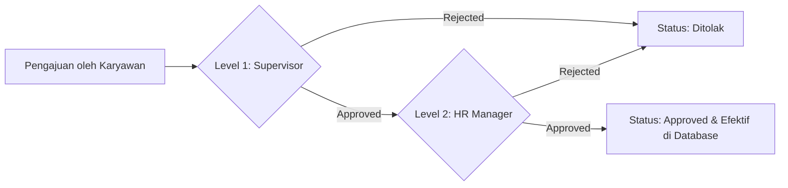

# 🔀 Modul: Workflow & Approval (Alur Pengesahan Berjenjang)

## 1. Ringkasan & Tujuan
Modul **Workflow & Approval** dirancang sebagai mesin orkestrasi persetujuan dokumen di seluruh aplikasi MiniPayroll:
1. **Definisi Alur Kerja (`Workflow Engine`)**: Menentukan tahapan persetujuan (multi-level approval: Step 1 -> Step 2 -> Final) untuk pengajuan seperti:
   - Pengajuan Cuti (*Leave Request*)
   - Perintah Kerja Lembur (*Overtime Request*)
   - Koreksi Absensi Manual (*Manual Attendance Correction*)
   - Finalisasi Periode Penggajian (*Payroll Closing*)
2. **Kotak Masuk Persetujuan (`Approval Inbox`)**: Antarmuka terpusat bagi para manajer / supervisor untuk meninjau, menyetujui (*Approve*), atau menolak (*Reject*) permohonan bawahan langsung.

---

## 2. Struktur Komponen & File Terkait

```text
Workflow & Approval Module
├── Controllers
│   └── Controllers/WorkflowController.cs       # Definisi dan konfigurasi alur kerja
├── Views
│   ├── Views/Workflow/Index.cshtml             # Pengaturan matriks workflow
│   └── Views/Approval/Index.cshtml             # Inbox daftar dokumen pending approval
└── Integrasi Modul Lain
    ├── Modul Leave (LeaveApprovalController)
    ├── Modul Overtime
    └── Modul Attendance
```

---

## 3. Alur Persetujuan Multi-Level (*Multi-Level Approval Flow*)



---

## 4. Status Dokumen dalam Workflow

| Status | Deskripsi |
| :--- | :--- |
| `Draft` | Dokumen baru dibuat, belum diajukan ke atasan. |
| `Pending` | Dokumen sedang menunggu giliran ditinjau oleh approver. |
| `Approved` | Seluruh level approver telah memberikan persetujuan. |
| `Rejected` | Salah satu approver menolak pengajuan (wajib menyertakan catatan penolakan). |
| `Cancelled` | Dibatalkan oleh pemohon sebelum diproses. |

---

## 5. Endpoints Utama

| Controller | Route | Method | Keterangan |
| :--- | :--- | :---: | :--- |
| `WorkflowController` | `/Workflow` | `GET` | Halaman pengaturan konfigurasi alur persetujuan. |
| `WorkflowController` | `/Workflow/Create` | `GET` / `POST` | Menambah definisi aturan workflow baru. |
| `WorkflowController` | `/Workflow/Edit/{id}` | `GET` / `POST` | Mengubah tahapan langkah persetujuan yang ada. |
| `Views/Approval/Index` | `/Approval` | `GET` | Dashboard terpusat daftar dokumen yang butuh persetujuan. |

